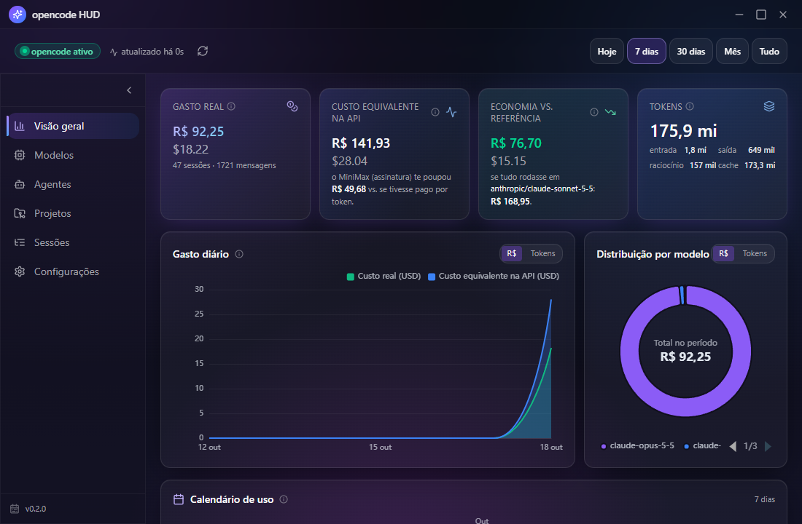
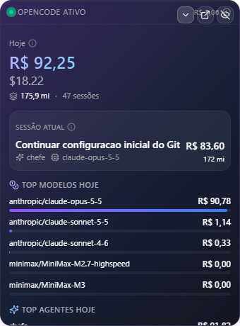
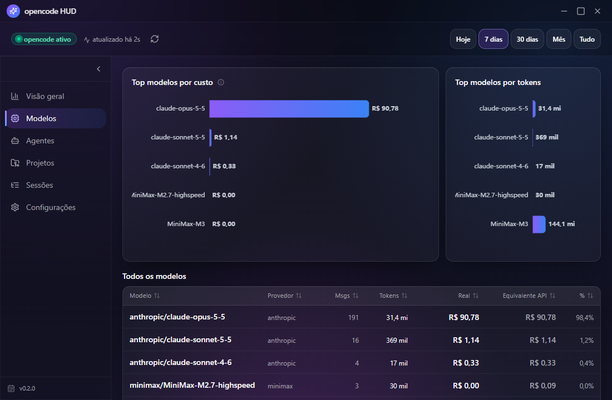
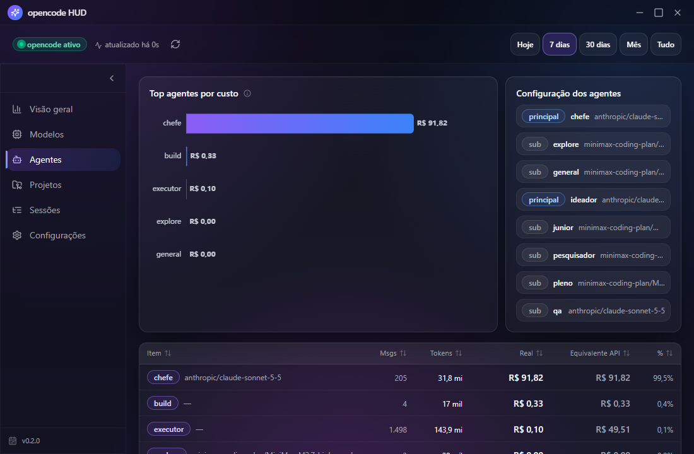
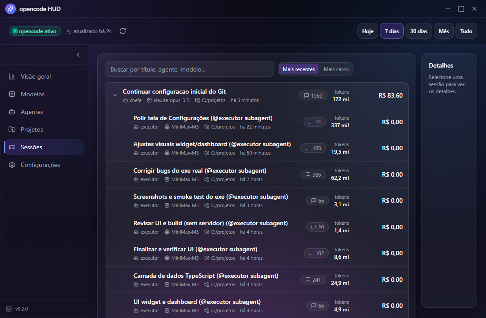
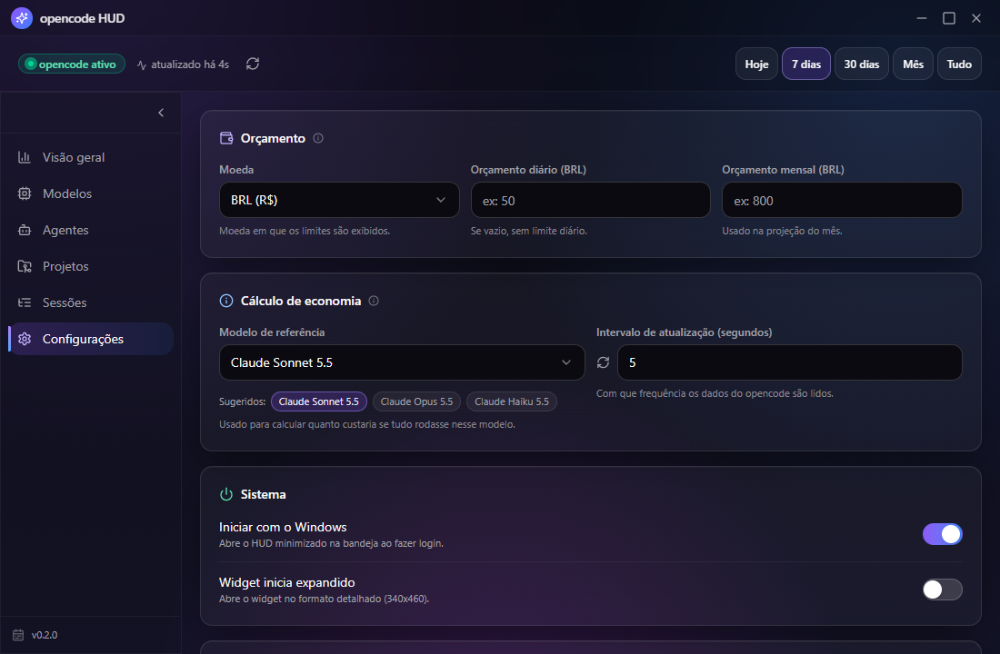

# opencode HUD

Painel desktop para Windows que mostra em tempo real quanto você gasta (e
economiza) usando o [opencode](https://opencode.ai).


> **English summary**: opencode HUD is a lightweight desktop panel (Tauri 2 +
> React + TypeScript) for Windows that reads opencode's local SQLite database
> read-only to show real-time cost, tokens, sessions, and savings. It bundles
> a tiny always-on-top widget plus a full dashboard with filters for today,
> 7/30 days, the current month, and all time, breakdowns by model, agent,
> project, and a session tree with sub-sessions. Budget alerts fire at 80%
> and 100% via Windows notifications, USD/BRL rates come from
> `economia.awesomeapi.com.br`, and the only outbound network calls are the
> FX rate and an optional `models.dev` lookup. MIT licensed.



<table>
  <tr>
    <td></td>
    <td></td>
  </tr>
  <tr>
    <td align="center"><em>Widget no canto superior direito (compacto)</em></td>
    <td align="center"><em>Widget expandido, com top modelos, agentes e sessões</em></td>
  </tr>
</table>

## Por que existe

O opencode já registra custo e tokens em cada mensagem, mas não oferece uma
visão clara do total gasto nem de quanto a sua assinatura realmente economiza
em relação ao preço por token de cada modelo. O HUD lê esses mesmos dados
localmente e mostra três números lado a lado:

- **Gasto real** — o que o opencode efetivamente registrou (em modelos de
  assinatura, como o MiniMax Coding Plan, costuma aparecer como R$ 0).
- **Custo equivalente na API** — quanto custaria se você tivesse pago por
  token, usando o preço pay-as-you-go do mesmo modelo. Para modelos em
  providers de assinatura, o HUD procura o mesmo `modelId` em providers
  pay-as-you-go equivalentes (via `FALLBACK_PROVIDERS` em
  `src/lib/data/pricing.ts`).
- **Economia vs. referência** — diferença entre o custo do seu *modelo de
  referência* (configurável, padrão Claude Sonnet 5.5) e o custo real dos
  mesmos tokens.

## Recursos

- **Widget sempre visível** — uma janela compacta sem decorações, com
  *always-on-top*, posicionada automaticamente no canto superior direito
  do monitor principal. Arrastável por toda a superfície; pode ser
  expandida para mostrar top modelos, agentes e últimas sessões. Sai da
  barra de tarefas (`skipTaskbar: true`).
- **Dashboard completo** com filtros para **Hoje**, **7 dias**, **30 dias**,
  **Mês** e **Tudo**, e as seções:
  - **Visão geral** — KPIs (gasto real, custo equivalente na API, economia
    vs. referência, tokens), gráfico de gasto diário, distribuição por
    modelo (donut), calendário de uso (heatmap), top modelos no período,
    card de hoje com orçamento diário e projeção do mês, e detalhe da
    sessão atual.
  - **Modelos** — barras por custo e por tokens, tabela completa com
    provider, tokens, custo, custo equivalente e referência.
  - **Agentes** — mesmas barras e tabela, mais a configuração lida de
    `opencode.jsonc`/`agents/*.md`.
  - **Projetos** — gasto agregado por diretório (última pasta do path).
  - **Sessões** — árvore com sub-sessões (filhos recursivos), detalhe ao
    lado e *breakdown* de tokens. Sub-sessões são somadas na raiz sem
    dupla contagem.
  - **Configurações** — moeda (BRL/USD), orçamento diário e mensal,
    modelo de referência, intervalo de polling (s), *autostart* e
    preferência expandida do widget.
- **Orçamento com alertas do Windows** — ao cruzar **80%** e **100%** do
  limite diário ou mensal, dispara uma notificação nativa. Disparo único
  por limite por dia/mês (estado persistido em `budget-watcher.json`).
- **Projeção do mês** — gasto atual extrapolado pelos dias restantes,
  mostrado ao lado da barra de orçamento mensal.
- **Calendário de uso** — heatmap estilo GitHub para até 365 dias.
- **R$/US$ com cotação automática** — busca em `economia.awesomeapi.com.br`
  (USD→BRL), com cache local de 6 h e *fallback* silencioso para o último
  valor conhecido.
- **Ícone na bandeja** com menu para abrir/ocultar dashboard, mostrar/ocultar
  widget, alternar *autostart* e sair. Clique esquerdo abre o dashboard.
- **Inicia com o Windows** via plugin `tauri-plugin-autostart` (configurável
  pela tela de Configurações e pelo menu da bandeja). A escolha do usuário
  é respeitada — o HUD não religa sozinho se você desligar.
- **Instância única** — uma segunda execução do executável apenas traz a
  janela do dashboard para frente (via `tauri-plugin-single-instance`).
- **Leve** — instalador `.exe` (NSIS) com cerca de **3,4 MB**; usa o
  **WebView2** que já vem instalado no Windows 11. Em Windows 10 o HUD usa
  o WebView2 presente no sistema (ou baixa silenciosamente na primeira
  execução).

## Galeria

| Tela | |
|---|---|
| **Visão geral** |  |
| **Modelos** |  |
| **Agentes** |  |
| **Sessões** |  |
| **Configurações** |  |

## Instalação

Baixe o instalador na página de
[Releases](https://github.com/diacovrapha/opencode-hud/releases/latest).
O artefato recomendado é `opencode-hud_0.2.0_x64-setup.exe` (instalador
NSIS por usuário, em `%LOCALAPPDATA%\opencode HUD`). O `.msi` está
disponível como alternativa.

> **Aviso sobre o SmartScreen.** Como o executável ainda **não é assinado
> digitalmente**, o Windows pode mostrar a tela "O Windows protegeu o
> computador". Clique em **Mais informações** → **Executar assim mesmo**
> para prosseguir. Esse aviso deve deixar de aparecer assim que o
> *signing* for configurado (veja o roadmap).

**Requisitos:**

- Windows 10 ou 11 (x64).
- **WebView2 Runtime** — já vem pré-instalado no Windows 11. Em Windows 10,
  a presença é detectada na primeira execução e o download silencioso é
  iniciado, se necessário.
- **opencode** instalado e com pelo menos uma sessão registrada — o HUD lê
  o banco local dele (veja a próxima seção).

## Como funciona e o que sai do seu PC

O HUD lê **apenas em modo leitura** o banco SQLite local do opencode em
`%USERPROFILE%\.local\share\opencode\opencode.db`. A camada nativa em Rust
(`src-tauri/src/db.rs`) abre o banco com `SQLITE_OPEN_READ_ONLY`, valida
que cada consulta enviada pelo front começa com `SELECT` ou `WITH`, rejeita
`;` no meio da query e impõe um **timeout de 10 s** via `progress_handler`
(consultas runaway são abortadas em vez de travar a thread).

O HUD também lê, do mesmo jeito, três arquivos que o próprio opencode já
guarda em disco:

- `%USERPROFILE%\.cache\opencode\models.json` — tabela de preços por modelo
  (dados de `models.dev`), usada para calcular custo equivalente na API e
  o custo no modelo de referência. Parseado uma vez e mantido em índice
  em memória, recarregado a cada 6 h.
- `%USERPROFILE%\.config\opencode\opencode.jsonc` (ou `.json`) — para
  identificar o modelo configurado em cada agente.
- `%USERPROFILE%\.config\opencode\agents\*.md` — agentes personalizados.

**As únicas chamadas de rede que o HUD faz** são:

1. A cotação USD→BRL em `https://economia.awesomeapi.com.br/json/last/USD-BRL`.
2. Nada mais obrigatório. Opcionalmente, se o `models.json` do opencode
   ainda não estiver presente no host, o front pode disparar uma busca em
   `models.dev` — comportamento idêntico ao do opencode.

Nenhum conteúdo das suas conversas, prompts ou respostas sai do seu PC.
O HUD só lê `cost`, `tokens`, `providerID`, `modelID`, `agent` e
metadados de sessão que o opencode já grava localmente.

### Como os números são calculados

- **Custo real** — `SUM(json_extract(m.data, '$.cost'))` por mensagem
  (`role = 'assistant'`), no fuso local.
- **Custo equivalente na API** — para cada mensagem, multiplica
  `tokens.input` por `cost.input / 1e6`, `tokens.output + tokens.reasoning`
  por `cost.output / 1e6` (raciocínio é cobrado como saída),
  `tokens.cache.read` por `cost.cache_read / 1e6` e `tokens.cache.write`
  por `cost.cache_write / 1e6`. Para modelos em providers de assinatura,
  procura o mesmo `modelId` em providers pay-as-you-go listados em
  `FALLBACK_PROVIDERS` (ex.: `minimax-coding-plan` → `minimax`/
  `minimax-cn`/`minimax-cn-coding-plan`). Se não achar, marca o grupo como
  `priceMissing` e o valor fica zerado.
- **Referência** — o mesmo cálculo de tokens, mas usando o
  `referenceModel` configurado (padrão `anthropic/claude-sonnet-5-5`).
- **"Hoje"** — é o dia local da *mensagem* (`time_created`), não da sessão
  inteira: uma mensagem gravada às 23:50 conta em "hoje" mesmo que a
  sessão tenha sido aberta ontem.
- **Sub-sessões** — somadas no aggregate da raiz; cada nó contribui
  *apenas* seu próprio aggregate, evitando dupla contagem.

## Integração com o opencode (opcional)

Para garantir que o HUD esteja aberto quando o opencode inicia, o repositório
irmão
[`opencode-config`](https://github.com/diacovrapha/opencode-config)
disponibiliza o arquivo
[`plugins/hud-launcher.js`](https://github.com/diacovrapha/opencode-config/blob/main/plugins/hud-launcher.js).
Basta copiar o arquivo para `~/.config/opencode/plugins/` (ou referenciá-lo
pela sua config) e ele será carregado automaticamente.

O plugin passa o argumento `--background` ao executar o HUD. Se o HUD já
estiver aberto, esse argumento é detectado por
`is_background_launch` em `src-tauri/src/lib.rs` e a chamada não cria uma
segunda janela. Caso contrário, o HUD abre em modo normal (dashboard
escondido e widget visível).

## Desenvolvimento

**Stack:**

- **Tauri 2** (Rust, `rusqlite` em modo somente leitura + `sysinfo` para
  detectar processos do opencode) e os plugins oficiais
  `single-instance`, `autostart`, `notification`, `store`,
  `window-state`, `http` e `opener`.
- **React 19 + TypeScript** (strict) com **Vite 5**.
- **Tailwind v4** e componentes baseados em **shadcn/ui** (copiados
  manualmente).
- **ECharts** para os gráficos de área, barras e *donut*; **Motion** para
  animações e **Zustand** para o estado de configurações.
- Testes em **Vitest** (lógica pura em `src/lib/data/*.test.ts`).

**Pré-requisitos:**

- **Node.js 20+**
- **Rust** (`stable-msvc` no Windows)
- **Visual Studio Build Tools** com a workload *C++* (para compilar o
  *crate* Rust em Windows).

**Comandos úteis:**

```bash
npm install                 # instala as deps do front
npm run test                # roda a suíte Vitest
npx tsc -b --noEmit         # só checagem de tipos
npx tauri dev               # dev: front + nativo juntos
npx tauri build             # gera o .exe e o .msi em src-tauri/target/release/bundle/
```

Os testes Rust ficam em `src-tauri/` e podem ser rodados com
`cd src-tauri && cargo test --lib` (um dos testes abre o `opencode.db`
real em modo somente leitura; se o banco não existir, o teste é pulado).

**Estrutura de pastas (resumida):**

```
src/
  lib/data/          lógica de dados pura e testada (Vitest)
    real.ts          DataSource que consome o SQLite + models.json
    aggregate.ts     funções puras (breakdowns, daily, session tree)
    pricing.ts       índice de preços + fallback de assinatura → pay-as-you-go
    periods.ts       janelas temporais ("hoje", 7d, 30d, mês, tudo)
    settings.ts      persistência de Settings (plugin-store)
    budget.ts        projeção do mês + checagem de limites
    budget-watcher.ts notificações nativas ao cruzar 80% e 100%
    usdbrl.ts        cotação USD→BRL com cache de 6 h
  views/             telas (Dashboard, Widget) e seções do dashboard
  components/        HUD + componentes UI
src-tauri/
  src/
    commands.rs      comandos IPC: db_query, read_opencode_file,
                     opencode_running, opencode_status_cmd, db_path_info
    db.rs            SQLite read-only com trava de tempo
    paths.rs         caminhos do opencode (db, models.json, config, agents)
    process.rs       detecção leve do processo do opencode
    opencode_files.rs leitura whitelisted (models, config, agents)
```

> **Rodando no navegador** (`npm run dev`), a UI usa dados de exemplo
> (mock) já que não há Tauri/IPC. Tudo o que envolve o banco de verdade
> só funciona dentro do app compilado (`npx tauri dev` ou `tauri build`).

## Roadmap

- Assinatura digital do executável para eliminar o aviso do Windows.
- Auto-update integrado.
- Mais idiomas além de pt-BR.

Sem prazos definidos — itens podem entrar e sair conforme a demanda.

## Licença

[MIT](LICENSE) — © 2026 diacovrapha.